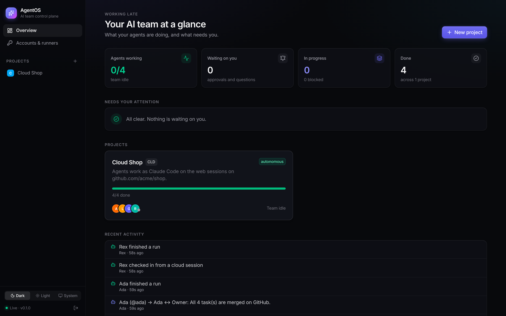
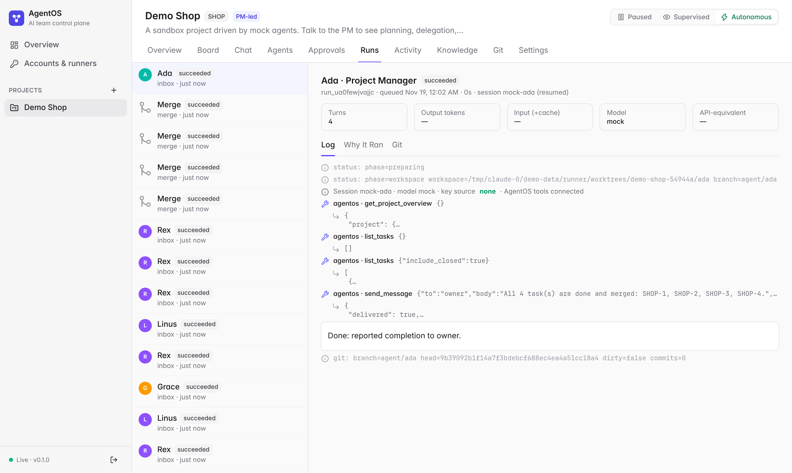

# AgentOS

**Manage a team of AI coding agents like a software team, without being the message broker between them.**

AgentOS is the orchestration layer above existing coding agents. You create projects, connect your coding-agent subscriptions (initially Claude Code on Pro/Max), and appoint an AI Project Manager. You describe what you want in plain language. The PM plans the work, breaks it into tasks, assigns them to agents, and coordinates reviews. AgentOS merges approved work and escalates important decisions to you. Everything is tracked in a web dashboard and persisted outside any agent's memory.

> Status: **v0.1, working end to end.** Runner mode is verified with real Claude Code agents on a subscription login. Cloud mode is verified against simulated Claude Code on the web and GitHub APIs, with its key assumptions checked by experiment. It also has a 34-test suite and a scripted browser walkthrough. See [docs/verification.md](docs/verification.md).


| Talk to your PM | Attention center |
|---|---|
|  |  |
| **Task detail: review, branch, commits, discussion** | **Runs: live log and "why it ran"** |
|  |  |

## Two ways to run agents

| | **Cloud mode** (Claude Code on the web) | **Runner mode** (Claude Code CLI) |
|---|---|---|
| Where agents run | Anthropic's cloud: each wake-up is a claude.ai/code session on that agent's account | On a runner: your VPS or your machine |
| Workspace | Your GitHub repository (agents push task branches) | Local git worktrees on the runner |
| How AgentOS starts work | The account's routine API trigger | `claude -p` headless on the runner |
| Merges | GitHub API | Local clone (optionally pushed) |
| Setup guide | [docs/cloud.md](docs/cloud.md) | [docs/operations.md](docs/operations.md) |

Both modes use the same PM, tasks, messages, approvals, guardrails and dashboard. Each agent's subscription pays for its own sessions.

## What works today

- **Projects and teams:** multiple projects, each with configurable agents (PM, developers, reviewer, tester…). Roles are free text with presets.
- **PM-led or collaborative coordination**, with the owner as final authority. Autonomy is set per project: *paused*, *supervised* (you approve plans and merges) or *autonomous* (within guardrails).
- **Agents talk through AgentOS, not through you:** messages, task threads, a team channel, @mentions and a read-only view of agent-to-agent conversations.
- **Task management:** epics, tasks and subtasks, dependencies (cycle-checked, with auto-unblock), acceptance criteria, a Kanban board, review and changes-requested loops.
- **Git you can trace:** one worktree per agent, one branch per task, commits attributed to agents and tasks. Reviewed work is merged into the base branch by AgentOS (conflicts go back to the author), optionally pushed.
- **Approvals:** agents must ask before architectural, security, destructive or production-impacting actions. A **permission gate** intercepts risky tool calls (force-push, `rm -rf /`, deploys, credential access…), turns them into approval requests, and grants a one-off permission when you approve.
- **Guardrails:** loop guard for agent ping-pong, hourly run budgets, bounded auto-continuation with escalation, per-account concurrency, and a global pause.
- **Reliability:** all state lives in AgentOS's database. Runs resume the agent's previous Claude session when possible and rebuild context from project state when not. Usage limits pause an account until its window resets. Crashed or lost runs hand their work back.
- **Dashboard:** attention center, project overview, board, task detail, chat, agents, approvals and decision log, runs with live logs and "why it ran", activity timeline, docs, git, settings, and accounts & runners.

## Subscription, not API billing

AgentOS runs the **unmodified Claude Code CLI** in headless mode, signed in with **your own subscription** through Anthropic's own login flow. AgentOS never sees, stores or relays your Claude credentials. A layered **billing guard** makes sure a run can't quietly switch to API billing. That could otherwise happen through a stray `ANTHROPIC_API_KEY`, or an `apiKeyHelper` in a repository's `.claude/settings.json` (verified by experiment). The guard allow-lists the environment, ignores repo settings, preflights `claude auth status`, and has a runtime tripwire on the stream's `apiKeySource`. Details and the terms analysis are in [docs/feasibility.md](docs/feasibility.md).

## Quick start (local)

Requirements: Node 22.13+, git, and the [Claude Code CLI](https://code.claude.com/docs) for real agents.

```bash
npm install
npm run build                     # builds the dashboard and the server
cd server
node dist/cli.js server --embedded-runner --seed-demo
# → prints the initial dashboard password; open http://127.0.0.1:4600
```

`--seed-demo` creates **Demo Shop**, a project staffed by *mock* agents (no usage spent). Tell its PM "Please build: - product catalog API - cart page" and watch the plan, implementation, review and merge happen.

To use real Claude agents:

1. **Accounts & runners → Add account** (provider: Claude Code). Add one per subscription, e.g. your two Max accounts.
2. Click **Sign-in instructions** and run the shown command on the runner machine. For the embedded runner that's the server host:
   ```bash
   CLAUDE_CONFIG_DIR='<shown dir>' claude auth login --claudeai
   ```
3. Wait for the status to show **Ready** (the runner confirmed a subscription login with no API key).
4. Create a project, add agents bound to those accounts, appoint a PM, and talk to the PM.

Development mode (hot reload): `npm run dev` (server on :4600) and `npm run dev -w web` (dashboard on :5173 with API proxy).

## Architecture in one picture

```
 Browser (dashboard) ──HTTPS──►  Control plane (VPS)                     Runner(s): VPS or your machines
                                 ├ REST API + SSE                        ├ long-poll for runs (outbound only)
                                 ├ Scheduler (who runs next, guards)  ◄──┤ git: repo clone + worktree per agent
                                 ├ MCP endpoint /mcp (per-run token)  ◄──┤ claude -p … (unmodified CLI, your login)
                                 └ SQLite: projects, tasks, messages,    │   └─ calls AgentOS tools over MCP
                                   approvals, runs, decisions, docs      └ billing guard, permission gate
```

Read more: [cloud mode](docs/cloud.md) · [architecture](docs/architecture.md) · [operations & deployment](docs/operations.md) · [roadmap](docs/roadmap.md) · [feasibility & terms](docs/feasibility.md) · [verification](docs/verification.md)

## Tests

```bash
npm test                                             # 34 tests: e2e runner mode (mock agents, real git + MCP), e2e cloud mode (simulated routines + GitHub), driver, billing guard, policy, orchestration
AGENTOS_REAL_CLAUDE=1 npm test -w server -- test/real-claude.smoke.test.ts   # live run with real Claude Code (uses a little real usage)
```

## Decisions that need you (the owner)

1. **Terms judgement.** Anthropic's terms allow signing in to the unmodified Claude Code CLI with your own subscription. They also say advertised limits assume "ordinary, individual usage". Whether orchestrated, mostly autonomous use of two personal Max accounts fits that is your call (see [feasibility](docs/feasibility.md#terms-and-credential-handling)). AgentOS keeps you in control: concurrency 1 per account by default, run budgets, pause, and supervised mode.
2. **Where runners live.** You can run one runner on the VPS next to the server (simplest), or runners on your own machines (credentials never leave them). Agents of one project currently share one runner, because they share git worktrees.
3. **GitHub token scope.** Cloud mode needs a fine-grained token with *Contents: read and write* on the project repository, so AgentOS can merge reviewed branches. Protect the base branch on GitHub if you want an extra safety net.
