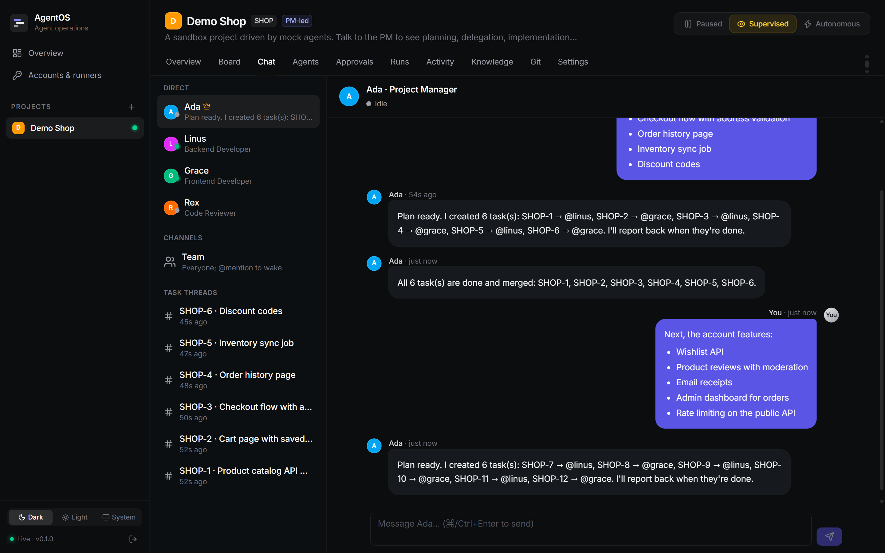
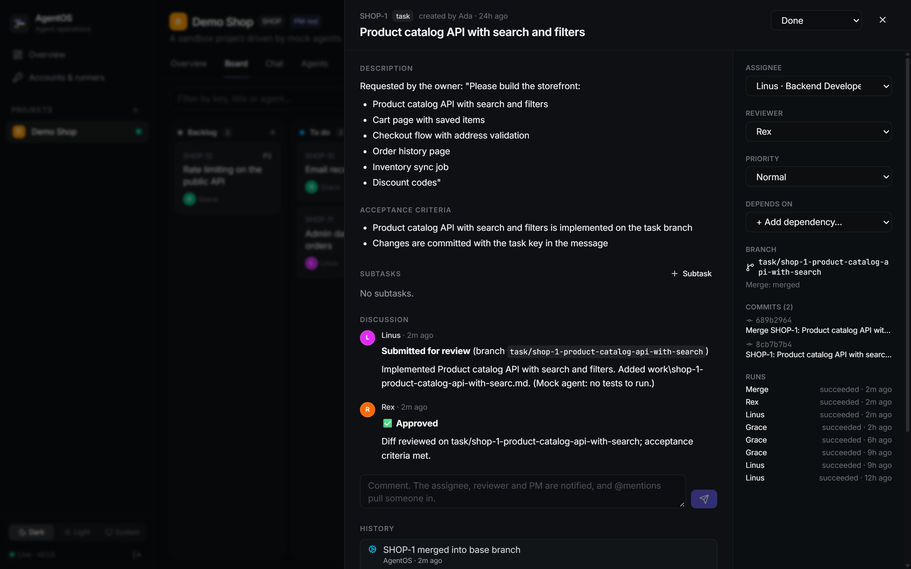
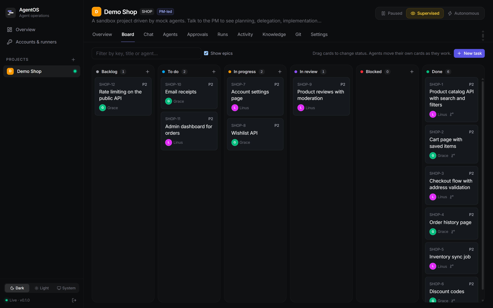
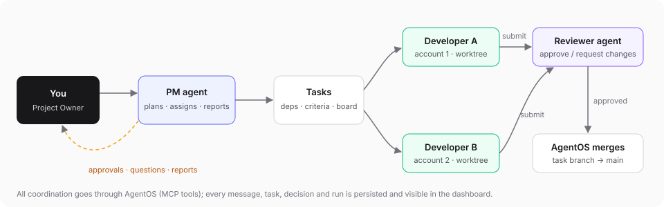

<div align="center">


# AgentOS

**Run a team of AI coding agents like a software team, and stop being the message broker between them.**

You talk to an AI project manager. It plans, splits the work into tasks, hands them to Claude Code agents running on *your own subscriptions*, gets the work reviewed and merges it. You approve what matters from a dashboard.

[](LICENSE)
[](https://nodejs.org)
[](https://code.claude.com/docs)
[](docs/verification.md)
[](docs/roadmap.md)

[Quick start](#-quick-start) · [How it works](#-how-it-works) · [Cloud mode](docs/cloud.md) · [Deploy](docs/operations.md) · [Architecture](docs/architecture.md) · [Roadmap](docs/roadmap.md)


<sub>Operations view with the bundled demo project (mock agents, simulated day of activity).</sub>

</div>

---

## Why AgentOS

Running several coding agents at once turns you into a switchboard: copy this plan to that agent, paste the review back, remember who is doing what, merge by hand. AgentOS takes that job.

- 🧑‍💼 **An AI PM in charge.** Describe the goal in plain language. The PM writes the plan, creates epics, tasks and acceptance criteria, and assigns them.
- 🤝 **Agents talk to each other through AgentOS, not through you.** Messages, task threads, a team channel, @mentions, reviews and approvals all go through one tool channel (MCP).
- 💳 **Your subscriptions, not an API bill.** Agents are the unmodified Claude Code CLI, signed in to your own Pro/Max accounts. A billing guard stops any run that would quietly switch to API billing.
- 🧠 **State outside any agent's memory.** Projects, tasks, decisions, docs and run history live in AgentOS's database. A fresh session picks up exactly where the last one stopped.
- 🛡️ **You keep the final say.** Paused, supervised or autonomous per project. Risky actions (force-push, deletes, deploys, credential access) become approval requests.

## ✨ Features

| | |
|---|---|
| **Projects and teams** | Several projects, each with its own agents: PM, developers, reviewer, tester. Roles are free text. |
| **Task management** | Epics, tasks, subtasks, dependencies with cycle checks and auto-unblock, a Kanban board, review and changes-requested loops. |
| **Git you can trace** | One branch per task, commits attributed to agents and tasks, reviewed work merged by AgentOS. Conflicts go back to the author. |
| **Approvals and a permission gate** | Agents must ask before architectural, security, destructive or production-impacting actions. Risky tool calls are intercepted and wait for you. |
| **Guardrails** | Loop guard for agent ping-pong, hourly run budgets, per-account concurrency, bounded auto-continuation, a global pause. |
| **Reliability** | Usage limits pause an account until its window resets. Lost or crashed runs hand their work back. Sessions resume when possible and rebuild context when not. |
| **Operations view** | Run lanes per agent on a time axis (see concurrency, idle gaps and failures at a glance), KPIs with deltas, tasks completed, and per-agent utilisation. |
| **Dashboard** | Attention center, board, task detail, chat, agents, approvals and decision log, runs with live logs and "why it ran", activity, docs, git, settings. Works on phones too. |

<table>
  <tr>
    <td width="50%"><p align="center"><sub><b>Chat</b>: give the PM an objective, get a plan back</sub></p></td>
    <td width="50%"><p align="center"><sub><b>Task detail</b>: review, branch, commits, discussion</sub></p></td>
  </tr>
  <tr>
    <td width="50%"><p align="center"><sub><b>Runs</b>: live log and why each run started</sub></p></td>
    <td width="50%"><p align="center"><sub><b>Board</b>: agents move their own cards</sub></p></td>
  </tr>
</table>

## 🧭 How it works



```
 Browser (dashboard) ──HTTPS──►  Control plane (your VPS)                Agents
                                 ├ REST API + live updates (SSE)         ├ Cloud mode: Claude Code on the web sessions,
                                 ├ Scheduler: who runs next, guards      │   one per wake-up, on each account
                                 ├ MCP endpoint /mcp (per-run auth)  ◄───┤ Runner mode: `claude -p` on your VPS or machine,
                                 └ SQLite: projects, tasks, messages,    │   one git worktree per agent
                                   approvals, runs, decisions, docs      └ both call AgentOS tools over MCP
```

### Two ways to run agents

| | ☁️ **Cloud mode** | 🖥️ **Runner mode** |
|---|---|---|
| Where agents run | Anthropic's cloud. Each wake-up is a claude.ai/code session on that agent's account | Your VPS or your own machine |
| Workspace | Your GitHub repository; agents push task branches | Local git worktrees on the runner |
| How AgentOS starts work | The account's routine API trigger | `claude -p` headless |
| Merges | GitHub API | Local clone, optionally pushed |
| Good for | No machine to keep busy; any repo on GitHub | Repos that need local tools (SDKs, engines, GPUs) |
| Setup | [docs/cloud.md](docs/cloud.md) | [docs/operations.md](docs/operations.md) |

Both modes share the same PM, tasks, messages, approvals, guardrails and dashboard. Each agent's own subscription pays for its sessions.

## 🚀 Quick start

Requirements: **Node 22.13+**, **git**, and the [Claude Code CLI](https://code.claude.com/docs) for real agents.

```bash
git clone https://github.com/zcrossoverz/agent-os.git
cd agent-os
npm install
npm run build
node server/dist/cli.js server --embedded-runner --seed-demo
# prints the initial dashboard password, then open http://127.0.0.1:4600
```

`--seed-demo` creates **Demo Shop**, a project staffed by *mock* agents, so nothing touches your usage. Tell its PM:

> Please build: - product catalog API - cart page

and watch the plan, the implementation, the review and the merge happen on the board.

### Use real Claude agents

1. **Accounts & runners → Add account.** Add one per Claude subscription.
2. **Sign in** with the command the dashboard shows. It is Anthropic's own login flow, so AgentOS never sees your credentials.
3. Wait for **Ready**. The runner has confirmed a subscription login with no API key in play.
4. **Create a project**, add agents bound to those accounts, make one of them the PM, and start talking.

Prefer agents in the cloud? Follow the [cloud mode guide](docs/cloud.md). It takes about ten minutes per account.

### Deploy

One container runs the control plane, the dashboard and an embedded runner:

```bash
docker compose -f deploy/docker-compose.yml up -d --build
```

Put TLS in front with the included [Caddyfile](deploy/Caddyfile) or nginx. systemd units are in [`deploy/`](deploy/). Details: [operations guide](docs/operations.md).

## 💳 Subscription, not API billing

AgentOS runs the **unmodified Claude Code CLI**, signed in with **your own subscription** through Anthropic's login flow. It never sees, stores or relays your Claude credentials.

A run can silently fall back to API billing through a stray `ANTHROPIC_API_KEY`, or through an `apiKeyHelper` in a repository's `.claude/settings.json` (verified by experiment). The billing guard closes both: it builds the agent's environment from an allow-list, ignores repo-level settings, preflights `claude auth status` and kills a run whose stream reports any API key source. The full analysis is in [docs/feasibility.md](docs/feasibility.md).

> [!IMPORTANT]
> Anthropic's terms allow signing in to the unmodified Claude Code CLI with your own subscription, and also say that advertised limits assume ordinary, individual usage. Whether an orchestrated, mostly autonomous setup fits your plan is your call. AgentOS keeps you in control with concurrency 1 per account by default, run budgets, pause and supervised mode. See [feasibility & terms](docs/feasibility.md#terms-and-credential-handling).

## ✅ Verified, not just written

- **35 automated tests**: end-to-end runner mode with mock agents over real git and MCP, end-to-end cloud mode against simulated routine and GitHub APIs, the driver, the billing guard, policies and orchestration.
- **Live runs**: runner mode with real Claude Code agents on a subscription login, and cloud mode with real routine-fired Claude Code on the web sessions working against a deployed AgentOS.
- **Scripted browser walkthrough** of the dashboard.

```bash
npm test                                                                         # the full suite
AGENTOS_REAL_CLAUDE=1 npm test -w server -- test/real-claude.smoke.test.ts      # one live run (uses a little real usage)
```

Details and the evidence behind each claim: [docs/verification.md](docs/verification.md).

## 🗺️ Roadmap

- [x] Core orchestration, dashboard, approvals, guardrails, billing guard
- [x] Runner mode and cloud mode
- [x] Docker deployment
- [ ] A pull request per task, with CI status and auto-fix
- [ ] Projects spread over several runners
- [ ] Codex CLI and Gemini CLI drivers
- [ ] Per-agent sandboxing and network policy
- [ ] Usage-aware account balancing and notifications

The full plan and known limitations: [docs/roadmap.md](docs/roadmap.md).

## 🤝 Contributing

Issues and pull requests are welcome. For development with hot reload:

```bash
npm run dev            # server on :4600 with an embedded runner
npm run dev -w web     # dashboard on :5173, proxying the API
```

Run `npm test` and `npm run typecheck` before opening a PR.

If AgentOS saves you from copy-pasting between agents, a ⭐ helps other people find it.

## License

[AGPL-3.0](LICENSE). You can use, change and self-host AgentOS freely. If you offer a modified version to others as a network service, you must share your changes under the same license.
